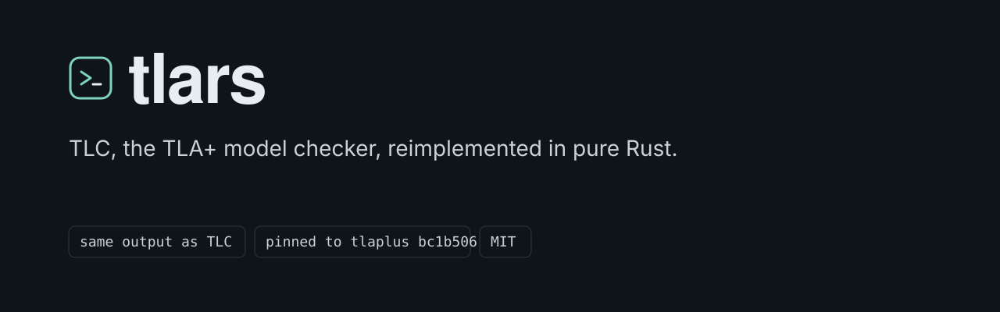

<p align="center"></p>

tlars is a reimplementation of TLC, the TLA+ model checker, in pure Rust. The goal is a drop-in replacement whose output, exit codes and error messages match TLC byte for byte. It tracks one TLC revision, [tlaplus bc1b506](https://github.com/tlaplus/tlaplus/tree/bc1b506bdcad80bb518bf3776a9161c34ff0fc4c), and checks itself against that TLC.

## Status

tlars cannot check models yet. The SANY front end (parser, semantic analysis, level checking, linter and PlusCal validation) is done and matches TLC on all 433 modules of [tlaplus/Examples](https://github.com/tlaplus/Examples). Values and constant evaluation are in progress. The plan is in [docs/DESIGN.md](docs/DESIGN.md) and the current milestone in [docs/M2.md](docs/M2.md).

## Build and test

The toolchain, a JDK and the pinned TLC come from the Nix flake.

```sh
nix develop
cargo test --release --workspace
```

The tests compare tlars with TLC on recorded outputs. To compare with TLC on tla-ts's conformance corpus, run `cargo run --release -p xtask -- conformance run`.

## License

MIT. tlars includes and translates code from TLC and uses test material from tlaplus/Examples and tla-ts; see [THIRD_PARTY_NOTICES.md](THIRD_PARTY_NOTICES.md).
